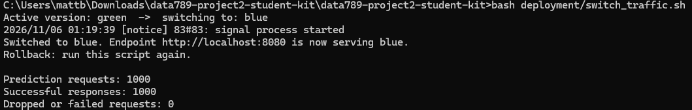

# Blue-Green Deployment Design (fill this in)

> Deliverable for Part B. Explain the strategy and show it working with the
> provided `docker-compose.blue-green.yml` + `switch_traffic.sh`. No Kubernetes.

## 1. Strategy
- What "blue" and "green" are here, and which one serves live traffic.
    - Blue and green are separate deployments of the prediction API. Both are running. Nginx currently routes prediction requests to blue while green is on standby.
- How a new version is brought up alongside the old one.
    - The updated API starts in the standby container while nginx continues sending requests to the active container.

## 2. Cutover
- How `switch_traffic.sh` flips nginx from one version to the other.
    -  `switch_traffic.sh` checks that the standby API is healthy, edits nginx.conf so the stanby API becomes the active backend, and reloads nginx.
    -  New requests go to that API trhough the same address on port 8080
- Why the reload is zero-downtime (in-flight requests drain).
    - New workers send new requests to the new API, while the old workers finish requests already in progress before they exit.

## 3. Health gate & rollback
- The health check performed before cutover.
    - Before switching traffic, the script uses curl to check the standby API’s /health endpoint. If the check succeeds, the switch proceeds.
    - If 20 attempts fail, nginx keeps routing requests to the current API.
- How you roll back (hint: run the switch again).
    - To roll back, run bash deployment/switch_traffic.sh again.
    - If green is serving traffic, the script checks that blue is healthy, then reloads nginx to route new requests back to blue.

## 4. How this maps to Kubernetes (1 short paragraph)
- What the nginx upstream + reload becomes in K8s (Service selector / two
  Deployments). You will build the K8s version in a later unit.
  
  In Kubernetes, blue and green would run as two separate Deployments behind one Service. The Service’s selector would initially send traffic to Pods labeled color=blue. Once the green Pods are ready, changing the selector to color=green would take the place of editing the nginx upstream and reloading nginx. New connections would go to green, and changing the selector back to blue would roll traffic back.
  

## 5. Evidence

During the green-to-blue rollback test, all 1,000 prediction requests succeeded.
